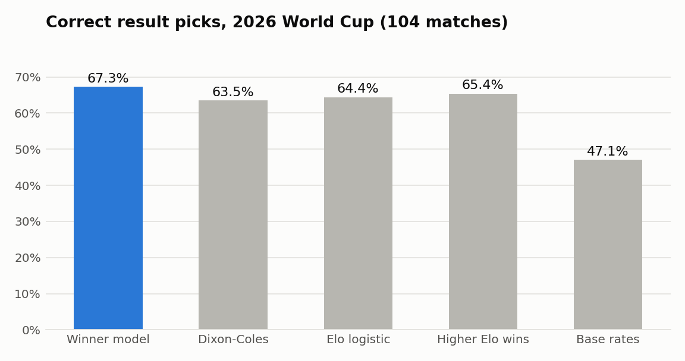
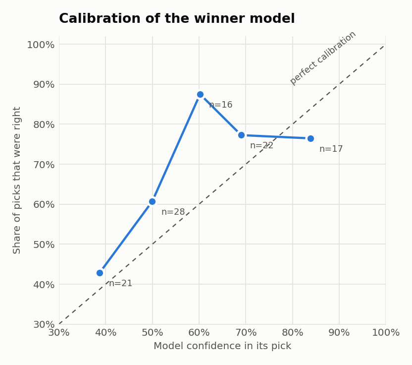
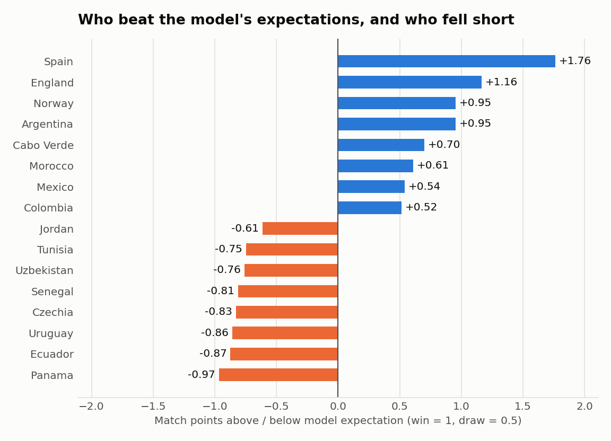
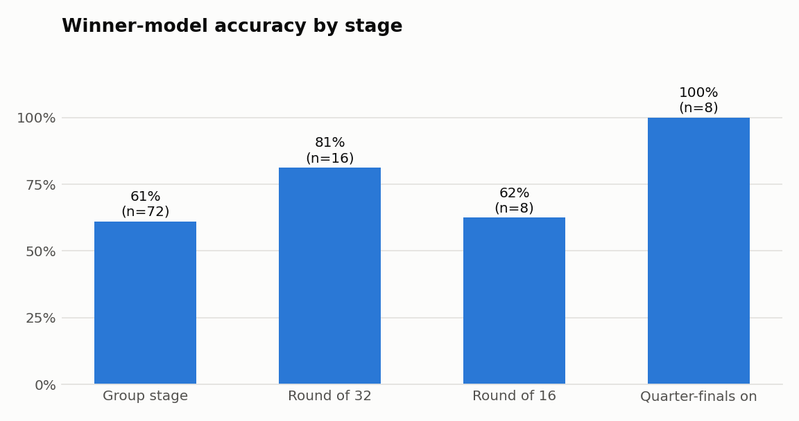

# International Soccer Match Predictor

Forecasting international soccer matches from 150 years of results, built for and tested on the
**2026 FIFA World Cup**.

The project pulls every men's international since 1872, builds team ratings and form features that
only use information available before kick-off, fits two models (one for the result, one for
goals), and then checks them against reality: historical backtests, a bookmaker benchmark, and a
full retrospective on the World Cup once it finished.

## Results: 2026 World Cup

For each of the 104 matches, the models were refitted on everything played before that day and
asked for a forecast. No match was predicted by a model that had seen it.

| | |
| --- | --- |
| Match result (home / draw / away) called correctly | **70 of 104 (67.3%)**, 95% interval 58–76% |
| Winner called correctly when the match had one | 70 of 80 (87.5%) |
| Over / under 2.5 goals called correctly | 61 of 104 (58.7%) |
| Exact scoreline called correctly | 11 of 104 (10.6%) |

<p>
  
  
</p>

How the winner model compares with simpler approaches on the same 104 matches (for RPS, log loss
and Brier, lower is better):

| Model | Accuracy | RPS | Log loss | Brier |
| --- | --- | --- | --- | --- |
| **Winner model** (this project) | **67.3%** | **0.1507** | **0.8273** | **0.4810** |
| Logistic regression on Elo only | 64.4% | 0.1600 | 0.8532 | 0.5005 |
| Dixon-Coles goal model | 63.5% | 0.1674 | 0.8694 | 0.5116 |
| Always pick the higher-rated team | 65.4% | – | – | – |
| Historical base rates | 47.1% | 0.2295 | 1.0546 | 0.6365 |

### What I take from it

- **The winner model beat every baseline on every metric**, but 104 matches is a small sample.
  The gap to "pick the higher-rated team" is two matches. The probability scores are the stronger
  evidence, since they use the whole forecast and not just the top pick.
- **This was a tournament that went to form.** The two highest-rated teams going in (Spain and
  Argentina) met in the final, and all of the last eight matches were won by the model's pick.
  Accuracy on past tournaments was closer to 60%, so I'd expect that, not 67%, next time.
- **Draws are where the misses are.** 24 matches were level at full time and the model made a
  draw its top pick once. Its average draw probability (23%) matched how often draws happened
  (23%), so the probabilities are sensible; a draw is just almost never the single most likely
  outcome.
- **The goal model ran low.** It expected 2.46 goals a match and got 2.96, and called "over" in
  43% of matches when 56% went over. My best guess is the expanded 48-team format, which put more
  lopsided matchups in the group stage than past World Cups had, but I haven't tested that.
- **It did not beat the betting market.** On the 34 matches where I had bookmaker odds, the model
  and the market favourite were each right 27 times. That's the expected result, and it's why the
  market is in here as a benchmark and not as something to beat.

<p>
  
  
</p>

The full write-up, with round-by-round tables, the biggest upsets, team over- and
under-performers and Elo movement, is in
[`reports/world_cup_2026/REPORT.md`](reports/world_cup_2026/REPORT.md). Match-level data is in
[`match_predictions.csv`](reports/world_cup_2026/match_predictions.csv).

## How it works

```
results (1872 → today)
   │
   ├─► Elo ratings ──────────────┐
   ├─► recent form, rest, etc. ──┼─► winner model ──► P(home / draw / away)
   ├─► confederation bias ───────┤
   └─► Dixon-Coles goal model ───┴─► score matrix ──► scorelines, over/under, both teams to score
```

1. **Data.** Results come from the open
   [martj42/international_results](https://github.com/martj42/international_results) dataset
   (about 50,000 matches) and are stored in SQLite.
2. **Elo ratings.** Computed from scratch by replaying every match in order, with weights for
   match importance and winning margin.
3. **Features.** Elo, exponentially weighted form (goals, results, results relative to Elo
   expectation), rest days, competition type, and a correction for the fact that Elo ratings
   aren't well calibrated between confederations that rarely play each other.
4. **Goal model.** A Dixon-Coles model gives each team an attack and a defence rating, fitted by
   time-weighted maximum likelihood. It produces a probability for every scoreline.
5. **Winner model.** A regularised multinomial logistic regression on the features above plus the
   goal model's expected goals. It exists because validation showed the goal model alone was no
   better at picking results than a two-variable Elo regression.
6. **Calibration.** The goal model's over/under probabilities are corrected with isotonic
   regression fitted on a held-out period.

The thing I was most careful about is leakage. Every feature for a match is computed from earlier
matches only, calibration is fitted on data the model didn't train on, and every backtest refits
the models for each fold.

### Validation before the tournament

Walk-forward by year (2012–2025, 9,652 matches) and with eight whole tournaments held out
(855 matches):

| Model | Walk-forward RPS | Accuracy | Held-out tournaments RPS | Accuracy |
| --- | --- | --- | --- | --- |
| **Winner model** | **0.1691** | **60.1%** | **0.1798** | **60.4%** |
| Elo logistic | 0.1724 | 59.6% | 0.1848 | 57.4% |
| Dixon-Coles | 0.1739 | 59.3% | 0.1869 | 57.2% |
| Base rates | 0.2278 | 47.7% | 0.2298 | 46.5% |

### Bookmaker benchmark

During the tournament I collected odds snapshots from The Odds API to compare the model with the
market. That part of the code removes the bookmaker margin from prices, tracks line movement
between snapshots, and logs the model's pick next to the market favourite
([`reports/live_tracker/`](reports/live_tracker/)). One caveat on that log: it was started
part-way through the tournament and back-filled some matches that had already been played, so its
raw accuracy flatters the model. The report compares the market against the clean day-by-day
replay instead.

## Repository layout

```
soccer.py                 command-line entry point
src/
  core/                   odds math, score distributions, calibration, name matching, SQLite
  data_pipeline/          results ingest, Elo, feature table, odds collection
  models/                 Dixon-Coles goal model, winner model, over/under calibration
  backtest/               walk-forward validation, paper-trading log
  engine/                 match forecasts, prediction tracker, model-vs-market comparison
  evaluation/             2026 World Cup retrospective
reports/
  world_cup_2026/         report, match-level predictions, figures
  validation/             leaderboard of validation runs
  live_tracker/           picks logged during the tournament
data/                     SQLite database and raw downloads (rebuilt locally, not tracked)
```

## Running it

Python 3.10+.

```bash
python -m venv .venv && source .venv/bin/activate    # Windows: .venv\Scripts\activate
pip install -r requirements.txt

# build the database and models (about a minute)
python soccer.py ingest-results
python soccer.py compute-elo
python soccer.py fit
python soccer.py calibrate

# reproduce the numbers in this README
python soccer.py validate      # historical backtests
python soccer.py worldcup      # World Cup report, CSVs and figures

# forecast any matchup (trailing 1 = neutral venue)
python soccer.py predict "Brazil" "Ivory Coast" 1
```

```
Brazil  vs  Côte d'Ivoire  (neutral)
  PICK: Brazil   (63% confidence)
  Win:  Brazil 63%   |   Draw 26%   |   Côte d'Ivoire 11%
  Likely score: 1-0   1-0 (14%)   1-1 (12%)   2-0 (12%)
  xGoals: 1.6 - 0.8   |   O/U 2.5: Under (41% over)   |   BTTS: 44%
```

The odds commands (`snapshot`, `poll`, `board`, `scan`, `track`) need a free
[Odds API](https://the-odds-api.com) key in the `ODDS_API_KEY` environment variable. Everything
above works without one. The docstring at the top of `soccer.py` lists every command.

## Limitations

- Results only. No line-ups, injuries or expected-goals data, which is most of what the betting
  market knows and this model doesn't.
- Scores include extra time, and a match decided on penalties counts as a draw. That's the right
  target for a goals model but it means "draw" in a knockout round isn't the end of the story.
- One tournament is one tournament. The confidence interval on the headline accuracy is about
  ±9 points.
- The odds history from the tournament lives in a local database that isn't in the repo, so the
  market comparison is limited to the 34 matches in the saved tracker log.

## Data

Match results: [martj42/international_results](https://github.com/martj42/international_results) (CC0).
Odds: [The Odds API](https://the-odds-api.com).
